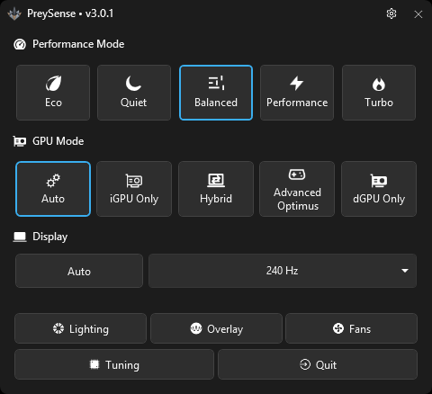
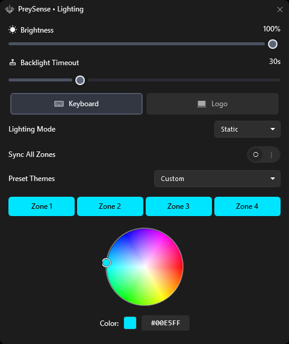
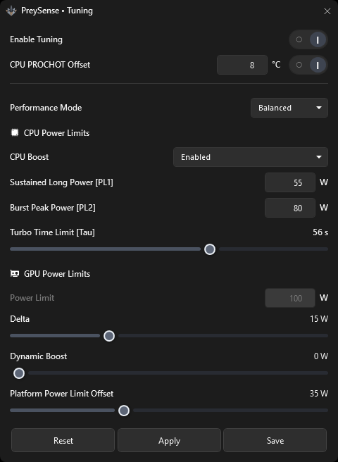
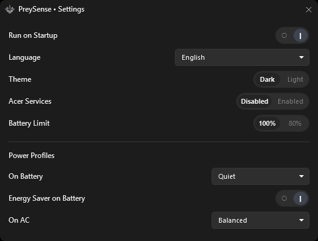
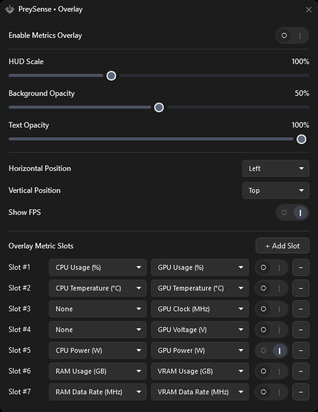

#  PreySense

PreySense is a lightweight Windows control suite for Acer Predator laptops. It replaces Predator Sense with a faster UI, deeper hardware control, and a bundled kernel driver for CPU/GPU power tuning.

Verified on **Acer Predator Helios Neo 16S (`PHN16S-71`)**. Other Predator models may work.

<p align="center">
  
</p>

## Features

### Performance modes
Quiet, Eco, Balanced, Performance, and Turbo with one-click switching. Source profiles can differ for AC and battery. The Predator key (beside Num Lock) shows or hides the app; hold it and press 1-5 to jump modes. The chassis Mode / Turbo key still cycles modes.

### Hardware tuning
Per-mode CPU and GPU power through the bundled **PreySenseDriver**:
- CPU PL1, PL2, Tau, and CPU Boost
- GPU Delta, Dynamic Boost, and platform power offset
- Optional global PROCHOT offset
- Factory calibration stored in `preysense.json`, with Reset to captured defaults
- Apply for a live test, Save to persist; saved profiles follow mode changes, startup, and resume once factory defaults are ready

### GPU and display
- GPU modes: Auto, Optimus, Advanced Optimus, and dGPU Only
- Refresh rate control, Auto refresh rate to 60Hz on battery.

### Fans
Per-mode Auto, Max, or Custom EC-style stages for Eco, Quiet, Balanced, Performance, and Turbo. CPU/GPU graphs set separate temps and boost percentages; both fans can run synchronized at the higher request, with 3°C cooldown hysteresis. Fans keep running while the app is in the tray.

### Lighting
Automatically detected RGB devices, including supported per-key keyboards, four-zone keyboards, light bars, logos, and mode/turbo keys. The themed keyboard editor supports click, Ctrl-click, Shift-click, and drag selection; color changes apply automatically. Existing four-zone effects and logo sync remain available. See [lighting support](docs/lighting_devices.md) for compatibility and verification limits.

### Overlay
Always-on-top telemetry with selectable CPU/GPU metrics, optional graphs, FPS, GPU Clock, CPU Active Clock, and CPU Effective Clock, and CPU VID when the driver can read it.

### Game streaming
The modified RubyLight preview adds live telemetry, performance modes and Auto, Custom, and Max fan control to its couch menu. See the [streaming setup](docs/streaming-control.md).

### Game profiles
Opt-in foreground game detection (`Games`) maps executables to a performance mode and optional CPU/GPU tuning overrides, restoring the prior mode and limits when the game exits.

### Battery and system
- Charge limit (80% or 100%) and USB power-off charging cutoff (0%, 10%, 20%, or 30%).
- LCD Overdrive toggle when supported by firmware.
- Run on Windows startup; Dark, Light, and Glass themes.
- In-app update checks with option to skip a version.
- Languages: English, Simplified Chinese, Hindi, Spanish, French, Turkish

### Appearance
Settings → Theme offers Dark, Light, and Glass. Glass uses the Windows 11 Desktop Acrylic backdrop with translucent controls and applies immediately to open windows. Windows 11 build 22621 or later is required for the native backdrop; older Windows versions keep a readable solid dark surface. Dropdown popups share the control material tint. The choice is saved in `General.Theme`; existing settings without that field retain their `LightTheme` preference.

## Screenshots

| Lighting | Tuning |
| :---: | :---: |
|  |  |

| Settings | Overlay editor |
| :---: | :---: |
|  |  |

<p align="center">
  
</p>

## Requirements

- Windows 10 or 11 x64
- Acer Predator laptop
- [.NET 10 Desktop Runtime x64](https://dotnet.microsoft.com/download/dotnet/10.0)
- Administrator privileges

## Install

1. Uninstall any previous PreySense version (required when upgrading from v2).
2. Download the latest `PreySense.exe` from [Releases](https://github.com/hammadzaigham/PreySense/releases).
3. Run as administrator. Close official Predator Sense if it is running.
4. Closing the window hides to the tray; use **Quit** to exit.

Run on Startup is off when no scheduled task exists. It reflects this install’s enabled logon task (current-user principal, any interactive logon), not a JSON default. Existing enabled tasks are checked against the running executable and current launch settings; missing tasks and disabled tasks/triggers stay off until you enable startup. Logon launches minimized at HighestAvailable, without a delay, idle/network requirements, battery restrictions, or a runtime limit. Keep the executable in a permanent local folder. Registration failures are written to `debug.log`.

## Disabling Acer OEM services

PreySense communicates directly with ACPI/WMI and hardware transports and does not require PredatorSense or Acer OEM background services. Leaving PredatorSense running can conflict with mode and fan control.

Helper PowerShell scripts are provided in [`docs/scripts/`](docs/scripts/):

```powershell
# Disable and stop Acer/PredatorSense OEM services (run as Administrator)
powershell -NoProfile -ExecutionPolicy Bypass -File "docs\scripts\Disable Acer Services.ps1"

# Re-enable and start Acer/PredatorSense OEM services (run as Administrator)
powershell -NoProfile -ExecutionPolicy Bypass -File "docs\scripts\Enable Acer Services.ps1"
```

## Quick start for tuning

1. Open **Tuning**. Controls become available once factory defaults are ready; section options are in **Settings → Tuning Settings**.
2. Choose a mode, set CPU/GPU values, then **Apply** or **Save**.
3. Switch modes as usual; saved profiles follow automatically.

Details: [driver tuning](docs/driver_tuning.md) · [v3.1.1](docs/releases/v3.1.1.md) · [v3.1.0](docs/releases/v3.1.0.md) · [v3.0.8](docs/releases/v3.0.8.md) · [v3.0.7](docs/releases/v3.0.7.md) · [v3.0.6](docs/releases/v3.0.6.md) · [v3.0.5](docs/releases/v3.0.5.md) · [v3.0.4](docs/releases/v3.0.4.md) · [v3.0.3](docs/releases/v3.0.3.md) · [v3.0.2](docs/releases/v3.0.2.md) · [v3.0.1](docs/releases/v3.0.1.md) · [v3.0.0](docs/releases/v3.0.0.md)

## Build

Requires the [.NET 10 SDK](https://dotnet.microsoft.com/download/dotnet/10.0).

```powershell
powershell -NoProfile -ExecutionPolicy Bypass -File .github\publish.ps1
```

Output: `dist\PreySense.exe`

## License

See [LICENSE](LICENSE).
