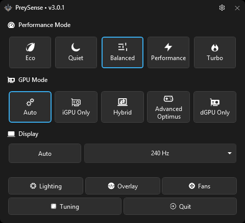
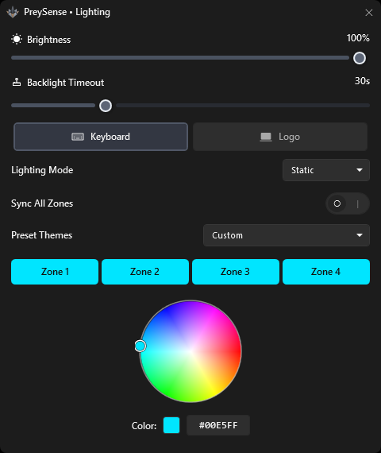
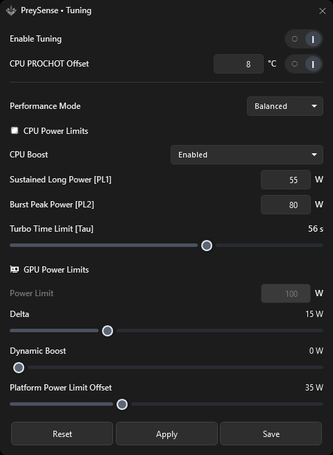
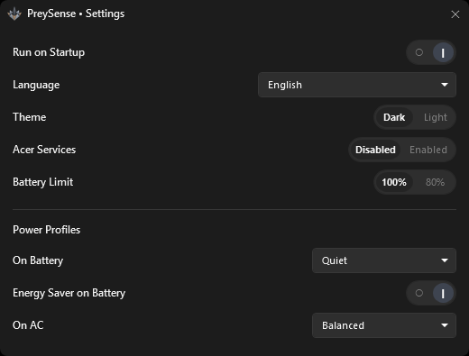
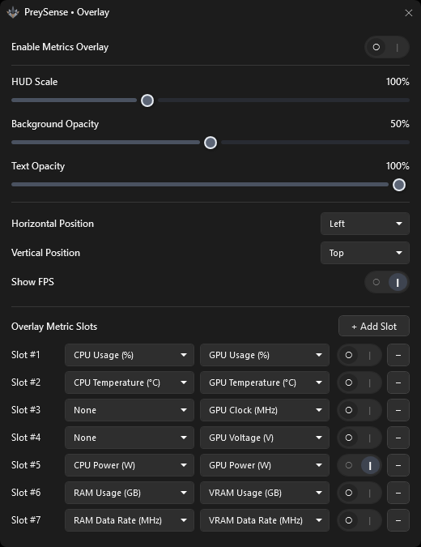

#  PreySense

PreySense is a lightweight Windows control suite for Acer Predator laptops. It replaces Predator Sense with a faster UI, deeper hardware control, and a bundled kernel driver for CPU/GPU power tuning.

Verified on **Acer Predator Helios Neo 16S (`PHN16S-71`)**. Other Predator models may work.

<p align="center">
  
</p>

## Features

### Performance modes
Quiet, Eco, Balanced, Performance, and Turbo with one-click switching. Source profiles can differ for AC and battery. The Predator key (beside Num Lock) shows or hides the app; hold it and press 1-5 to jump modes. The chassis Mode / Turbo key still cycles modes.

### Hardware tuning
Per-mode CPU and GPU power through the bundled **PreySenseDriver**:
- CPU PL1, PL2, Tau, and CPU Boost
- GPU Delta, Dynamic Boost, and platform power offset
- Optional global PROCHOT offset
- Factory calibration stored in `preysense.json`, with Reset to captured defaults
- Apply for a live test, Save to persist; saved profiles follow mode changes, startup, and resume when Enable Tuning is on

### GPU and display
- GPU modes: Auto, iGPU Only, Hybrid, Advanced Optimus, and dGPU Only
- Refresh rate control, Auto refresh rate to 60Hz on battery.

### Fans
Per-mode Auto, Max, or Custom EC-style stages for Eco, Quiet, Balanced, Performance, and Turbo. CPU/GPU graphs set separate temps and duties; both fans run at the higher duty, with a shared 0–5 s stage delay. Fans keep running while the app is in the tray.

### Lighting
Four-zone keyboard RGB plus cover logo lighting, with static colors, hardware effects, software animations, and optional logo sync.

### Overlay
Always-on-top telemetry with selectable CPU/GPU metrics, optional graphs, FPS, separate GPU Active / Effective clocks, and CPU VID when the driver can read it.

### Battery and system
- Charge limit (80% or 100%).
- Run on Windows startup, light/dark theme
- Languages: English, Simplified Chinese, Hindi, Spanish, French

## Screenshots

| Lighting | Tuning |
| :---: | :---: |
|  |  |

| Settings | Overlay editor |
| :---: | :---: |
|  |  |

<p align="center">
  
</p>

## Requirements

- Windows 10 or 11 x64
- Acer Predator laptop
- [.NET 10 Desktop Runtime x64](https://dotnet.microsoft.com/download/dotnet/10.0)
- Administrator privileges

## Install

1. Uninstall any previous PreySense version (required when upgrading from v2).
2. Download the latest `PreySense.exe` from [Releases](https://github.com/hammadzaigham/PreySense/releases).
3. Run as administrator. Close official Predator Sense if it is running.
4. Closing the window hides to the tray; use **Quit** to exit.

## Quick start for tuning

1. Open **Tuning** and turn on **Enable Tuning**.
2. Choose a mode, set CPU/GPU values, then **Apply** or **Save**.
3. Switch modes as usual; saved profiles follow automatically.

Details: [driver tuning](docs/driver_tuning.md) · [v3.0.2](docs/releases/v3.0.2.md) · [v3.0.1](docs/releases/v3.0.1.md) · [v3.0.0](docs/releases/v3.0.0.md)

## Build

Requires the [.NET 10 SDK](https://dotnet.microsoft.com/download/dotnet/10.0).

```powershell
powershell -NoProfile -ExecutionPolicy Bypass -File .github\publish.ps1
```

Output: `dist\PreySense.exe`

## License

See [LICENSE](LICENSE).
